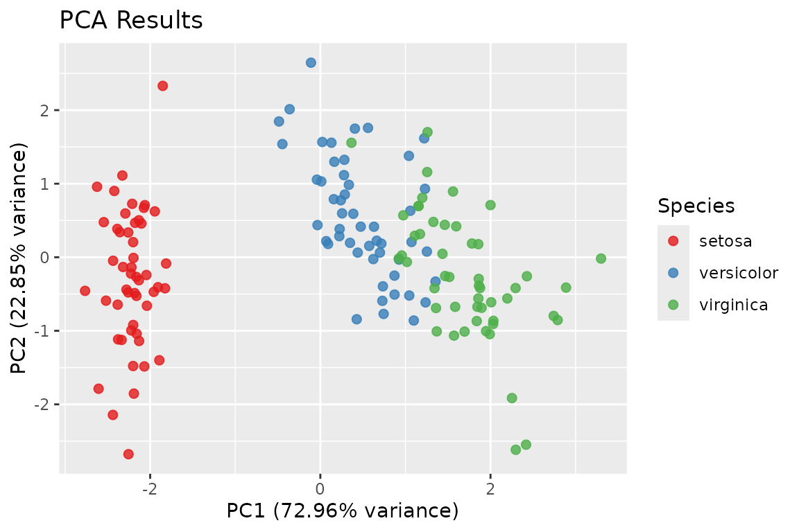

# Dimensionality reduction

[`fs_pca()`](https://elkronos.github.io/featR/reference/fs_pca.md) and
[`fs_svd()`](https://elkronos.github.io/featR/reference/fs_svd.md)
reduce dimension without selecting features. They replace the original
columns with a few new ones, each a weighted sum of all the inputs. You
still have to measure every variable, and the new columns are chosen
without reference to any outcome: they point in the directions of
largest variance, which need not be the directions that predict
anything. If you need to name the features you keep, use one of the
[filters](https://elkronos.github.io/featR/articles/filters.md),
[regularization
methods](https://elkronos.github.io/featR/articles/regularization.md),
or [wrappers](https://elkronos.github.io/featR/articles/wrappers.md)
instead.

Use [`fs_pca()`](https://elkronos.github.io/featR/reference/fs_pca.md)
on a data frame when you want tidy, labeled output: variance explained,
loadings, scores next to your label columns, and a plot. Use
[`fs_svd()`](https://elkronos.github.io/featR/reference/fs_svd.md) on a
numeric matrix when you want the raw singular values and vectors, for
compression or as input to your own code.

Both functions return a plain list, not an `fs_result`, so
[`selected()`](https://elkronos.github.io/featR/reference/selected.md)
and the other `fs_result` helpers do not apply.

## `fs_pca()`

Principal component analysis (PCA) finds the orthogonal directions along
which the data vary most. The first component is the direction of
largest variance, the second is the largest among directions
perpendicular to the first, and so on.

[`fs_pca()`](https://elkronos.github.io/featR/reference/fs_pca.md) runs
a PCA on the numeric columns of a data frame. Character, factor,
logical, and date columns are kept aside as labels, as is the column
named in `label_col`. By default it keeps two components; set `num_pc`
for more.

``` r

pca <- fs_pca(iris, num_pc = 2, label_col = "Species")
names(pca)
#> [1] "pc_loadings"   "pc_scores"     "var_explained" "pca_df"       
#> [5] "meta"          "plot"
pca$var_explained
#> [1] 0.7296245 0.2285076
pca$pc_loadings
#>                     PC1         PC2
#> Sepal.Length  0.5210659 -0.37741762
#> Sepal.Width  -0.2693474 -0.92329566
#> Petal.Length  0.5804131 -0.02449161
#> Petal.Width   0.5648565 -0.06694199
head(pca$pca_df)
#>          PC1        PC2 Species
#>        <num>      <num>  <fctr>
#> 1: -2.257141 -0.4784238  setosa
#> 2: -2.074013  0.6718827  setosa
#> 3: -2.356335  0.3407664  setosa
#> 4: -2.291707  0.5953999  setosa
#> 5: -2.381863 -0.6446757  setosa
#> 6: -2.068701 -1.4842053  setosa
```

How to read the output:

- `var_explained` is the share of the total variance each retained
  component carries. On `iris` the first two components carry 73.0% and
  22.9%, so together they keep about 96% of the variance in the four
  measurements. The vector sums to 1 only when you keep every component.
- `pc_loadings` holds the weights
  ([`prcomp()`](https://rdrr.io/r/stats/prcomp.html)’s `rotation`), one
  row per input column. PC1 weights the petal measurements and sepal
  length about equally (0.52 to 0.58), while PC2 is mostly sepal width
  (-0.92). The sign of a component is arbitrary: a component and its
  negation describe the same direction, so compare loadings within a
  column, not their signs across runs.
- `pc_scores` holds each observation’s coordinates on the components,
  and `pca_df` is the same scores with the label columns bound
  alongside.

By default columns are centered and scaled (`scale_data = TRUE`), so the
PCA runs on the correlation matrix. Leave scaling on unless every column
is in the same meaningful units; otherwise the column with the largest
variance dominates the first component. Scaling without centering
(`scale_data = TRUE, center_data = FALSE`) is an error.

### Missing values and constant columns

Before the decomposition,
[`fs_pca()`](https://elkronos.github.io/featR/reference/fs_pca.md) drops
every row with a missing value in the numeric columns, and it drops
every column with zero variance with a warning. Infinite values are an
error. `meta` records what was used:

``` r

pca$meta$n_rows_used
#> [1] 150
pca$meta$numeric_cols
#> [1] "Sepal.Length" "Sepal.Width"  "Petal.Length" "Petal.Width"
```

`iris` has no missing values, so all 150 rows are used. On real data,
check `meta$n_rows_used` and `meta$rows_kept`: a few gappy columns can
remove most of the rows without an error. `num_pc` cannot exceed the
number of usable columns, or the number of usable rows minus one.

### Plotting

[`fs_pca()`](https://elkronos.github.io/featR/reference/fs_pca.md)
builds a ggplot of PC1 against PC2, colored by `label_col`, whenever a
`label_col` is supplied, at least two components are kept, and ggplot2
is installed. The plot is returned in `$plot`; `plot = TRUE` also prints
it.

``` r

pca$plot
```



When no plot can be built, the list has no `plot` element at all, so
test with `"plot" %in% names(pca)`.

### Large data

Below 10 million cells (rows times numeric columns),
[`fs_pca()`](https://elkronos.github.io/featR/reference/fs_pca.md) uses
[`stats::prcomp()`](https://rdrr.io/r/stats/prcomp.html). At or above
that size it uses
[`bigstatsr::big_SVD()`](https://privefl.github.io/bigstatsr/reference/big_SVD.html)
on a temporary file-backed matrix, if bigstatsr is installed, and
computes only the requested components; without bigstatsr it falls back
to [`prcomp()`](https://rdrr.io/r/stats/prcomp.html). This engine can
return at most one fewer component than there are columns, so `num_pc`
equal to the number of columns is an error on large data. The large-data
engine recovers the total variance from column statistics, so
`var_explained` is still the share of the whole and not of the
components that were computed.

### Leakage

PCA never looks at the outcome, but it does learn from the rows it sees:
the centering, scaling, and loadings all come from the data. If you fit
it on all rows and then cross-validate a model on the scores, the test
rows have shaped the features.
[`fs_pca()`](https://elkronos.github.io/featR/reference/fs_pca.md) does
not return the centering and scaling values or a way to project new
rows. To apply a PCA learned on training rows to test rows, fit
[`stats::prcomp()`](https://rdrr.io/r/stats/prcomp.html) on the training
rows and call [`predict()`](https://rdrr.io/r/stats/predict.html) on it.
See [Validation and
leakage](https://elkronos.github.io/featR/articles/validation-and-leakage.md)
for the general rule.

## `fs_svd()`

The singular value decomposition (SVD) factors a matrix `X` into
`U D V'`: `D` holds the singular values in decreasing order, and the
columns of `U` and `V` are the left and right singular vectors. Keeping
the first `k` triplets gives the best rank-`k` approximation of `X`.

[`fs_svd()`](https://elkronos.github.io/featR/reference/fs_svd.md) is
the lower-level tool. It takes a numeric matrix `x` (or an all-numeric
data frame) and returns the singular values and vectors:

``` r

m <- as.matrix(mtcars)
s <- fs_svd(m, n_singular_values = 3, scale_input = TRUE)
round(s$singular_values, 3)
#> [1] 14.313  9.064  4.409
dim(s$left_singular_vectors)
#> [1] 32  3
dim(s$right_singular_vectors)
#> [1] 11  3
```

The left singular vectors have one row per observation (32 cars) and the
right singular vectors one row per column (11 variables), each with one
column per kept triplet. By default, `n_singular_values = NULL` keeps
all of them, `min(dim(x))`.

`x` must not contain `NA`, `NaN`, or `Inf`. Unlike
[`fs_pca()`](https://elkronos.github.io/featR/reference/fs_pca.md),
[`fs_svd()`](https://elkronos.github.io/featR/reference/fs_svd.md) drops
nothing for you, so remove or impute missing values first.

`scale_input = TRUE` (the default) centers and scales the columns first,
so the triplets factor `scale(x)`, not `x`. The column means and
standard deviations are not returned; keep them yourself if you need to
map results back to the original units. The other options are `FALSE`
(use `x` as is), `"center"`, and `"scale"`, which follows
[`base::scale()`](https://rdrr.io/r/base/scale.html) and, without
centering, divides by the root mean square rather than the standard
deviation. The dividing forms stop with an error if a column has zero
variance.

On centered and scaled data, the squared singular values divided by
`n - 1` are the PCA eigenvalues, so
[`fs_svd()`](https://elkronos.github.io/featR/reference/fs_svd.md) and
[`prcomp()`](https://rdrr.io/r/stats/prcomp.html) agree:

``` r

all_sv <- fs_svd(m)$singular_values
round(all_sv^2 / (nrow(m) - 1), 4)[1:3]
#> [1] 6.6084 2.6505 0.6272
round(prcomp(m, scale. = TRUE)$sdev^2, 4)[1:3]
#> [1] 6.6084 2.6505 0.6272
```

### Exact or approximate

`svd_method = "auto"` uses
[`base::svd()`](https://rdrr.io/r/base/svd.html) unless both of these
hold: you ask for fewer singular values than `min(dim(x))`, and the
smaller dimension of the matrix is larger than `svd_threshold` (default
100). Then it uses
[`RSpectra::svds()`](https://rdrr.io/pkg/RSpectra/man/svds.html), which
computes only the leading triplets and needs the RSpectra package.
`svd_method = "approx"` forces the approximate solver; if you ask for
all `min(dim(x))` values it falls back to the exact solver with a
message, because
[`RSpectra::svds()`](https://rdrr.io/pkg/RSpectra/man/svds.html) cannot
return the full set. If RSpectra converges on fewer values than
requested, featR warns and recomputes them exactly.

On a 400 by 150 matrix, the five leading singular values from both
solvers agree to within `1e-6`:

``` r

set.seed(1)
big <- matrix(rnorm(400 * 150), 400, 150)
approx <- fs_svd(big, n_singular_values = 5, svd_method = "approx")
exact  <- fs_svd(big, n_singular_values = 5, svd_method = "exact")
all.equal(approx$singular_values, exact$singular_values, tolerance = 1e-6)
#> [1] TRUE
```

Singular vectors are unique only up to sign, so the two solvers, or two
platforms, can return columns with opposite signs. Compare vectors with
[`abs()`](https://rdrr.io/r/base/MathFun.html) or through the
reconstructed matrix, not element by element.
